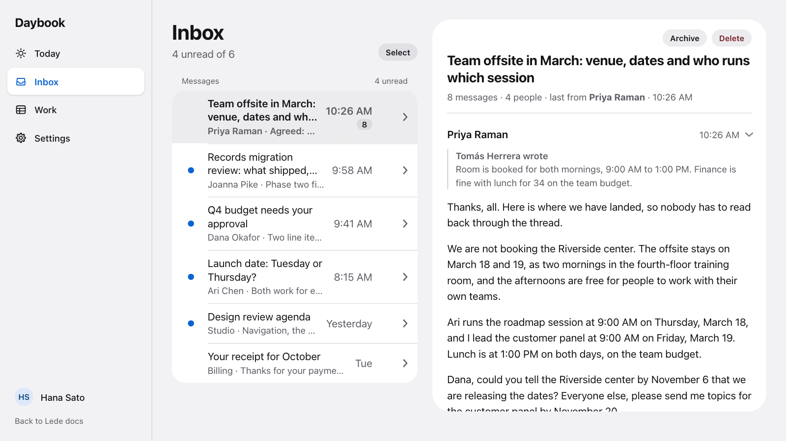

# <picture><source media="(prefers-color-scheme: dark)" srcset=".github/assets/mark-dark.png"></picture> Lede

Lede is a design system for React, installed from a shadcn registry. Every screen, section and row leads with its
takeaway, and detail opens on request. The name is the journalist's word for a story's opening line.

[Docs](https://lede.cloudcompute.com/) · [Daybook, the demo app](https://lede.cloudcompute.com/app) ·
[Install](#use-it-in-a-shadcn-project) · [Changelog](CHANGELOG.md) · [Releasing](docs/releasing.md)

A coding agent starts at https://lede.cloudcompute.com/llms.txt, the docs index it can read without JavaScript.
For Claude Code, install the `lede-design-system` skill of this release into the project:

```bash
mkdir -p .claude/skills/lede-design-system
curl -fsSL https://raw.githubusercontent.com/fairchild/lede-design/v0.7.1/.claude/skills/lede-design-system/SKILL.md \
  -o .claude/skills/lede-design-system/SKILL.md
```

<picture>
  <source media="(prefers-color-scheme: dark)" srcset="docs/screenshots/inbox-dark.png">
  
</picture>

## What's in it

| Layer | What it is | Examples |
| --- | --- | --- |
| [Tokens](https://lede.cloudcompute.com/foundations) | Color in four themes, type, spacing, radius and motion, under shadcn's variable names. | `--primary`, `--radius`, `--fill-control` |
| [Components](https://lede.cloudcompute.com/components) | Primitives, each a native element where HTML has one. | Button, Switch, ListGroup, Table |
| [Blocks](https://lede.cloudcompute.com/blocks) | The larger parts of a screen, page layouts among them. | AppShell, PageHeader, DataTable |
| [Flows](https://lede.cloudcompute.com/app) | Whole screens built from blocks. You pass data, hrefs and callbacks. | InboxFlow, OnboardingFlow |

Each layer builds on the one above it, and you install only the items you use. Stock shadcn components take on Lede's
theme too, because the tokens keep shadcn's names.

Components use [Base UI](https://base-ui.com) for the interactions HTML can't do, and ARIA only for what HTML can't
express. [Decisions](https://lede.cloudcompute.com/decisions) records how Lede is built and what checks it.

Lede is inspired by Apple's Human Interface Guidelines: **Hierarchy, Harmony, Consistency** and **Progressive
disclosure**.

*Lede is an independent project with no affiliation with Apple, and Apple doesn't endorse it. It ships no Apple fonts,
icons or assets.*

## Use it in a shadcn project

You need Node 22.12 or later and a client-rendered React 19 project, such as a Vite app, with Tailwind v4, the `@/*`
path alias and a `components.json`. `npx shadcn@latest init` creates that file, or write the shorter one in
[components.json](README.md#componentsjson) by hand. [Start from a new Vite app](#start-from-a-new-vite-app) sets up all of them
in an app made with create-vite. Lede's CSS runs in Chrome and Edge 111, Safari 18 and Firefox 151 or later.
[Limits](#limits) covers server rendering and older browsers.

1. Add the registry and the items you want. Keep `@lede/theme-provider` in the list: step 4 needs it, and most items
   don't install it.

   ```bash
   npx shadcn@latest registry add '@lede=https://lede.cloudcompute.com/r/v0.7.1/{name}.json'
   npx shadcn@latest add @lede/theme-provider @lede/list
   ```

   The CLI copies the source into your project and installs what each item depends on, npm packages included. The URL
   pins a release, and a release's files never change. [llms.txt](https://lede.cloudcompute.com/llms.txt) lists every
   item with its name and import line.

2. Import the styles once, at the end of your global CSS file, after your shadcn globals. The path is relative to that
   file. This one suits `src/index.css`.

   ```css
   @import "./styles/lede/index.css";
   ```

3. Import each component from its own file. Components land in `components/lede/` and styles in `styles/lede/`, under
   `src/` if your project has one. Each item's docs land in `components/lede/docs/`, with a guide to them in its
   `README.md`.

   ```tsx
   import { ListGroup, ListRow } from '@/components/lede/list';
   ```

4. Wrap your app in `ThemeProvider` and `LinkProvider`. `surface="grouped"` and `min-h-dvh` make the wrapper paint the
   theme's background over the whole page. `LinkProvider` routes Lede's links through your router, so leave it out if
   you have none. It comes with `@lede/lede-utils`, which every item but `lede-theme` installs, so there's no
   `@lede/link` to add. A hero flow, such as `@lede/inbox`, brings no gutter of its own: put it in `Page` or in
   AppShell's main region, as its reference page's example does.

   ```tsx
   import { LinkProvider } from '@/components/lede/link';
   import { ThemeProvider } from '@/components/lede/theme-provider';
   import { RouterLink } from './router-link';

   <ThemeProvider surface="grouped" className="min-h-dvh">
     <LinkProvider component={RouterLink}>
       <App />
     </LinkProvider>
   </ThemeProvider>
   ```

   For React Router, `src/router-link.tsx` is this adapter.

   ```tsx
   import { Link } from 'react-router';
   import type { LinkComponent } from '@/components/lede/link';

   export const RouterLink: LinkComponent = ({ href, ref, ...props }) =>
     /^(https?:|mailto:|tel:|#)/.test(href) ? <a ref={ref} href={href} {...props} /> : <Link ref={ref} to={href} {...props} />;
   ```

To move to a later release, read the [CHANGELOG](CHANGELOG.md), change the version in the registry URL in
`components.json` and run the same `add` with `-o`. That overwrites your copies, including any edits you made to them.

### Start from a new Vite app

These commands give a new app what the steps need. They were run as written with create-vite 9, Vite 8, TypeScript 7
and shadcn 4.23.

```bash
npm create vite@latest my-app -- --template react-ts --no-interactive
cd my-app
npm install
npm install tailwindcss @tailwindcss/vite
```

Replace `vite.config.ts` with this one, which adds Tailwind's plugin and the `@` alias. Vite's dev server doesn't read
the alias from the tsconfig files.

```ts
import { fileURLToPath, URL } from 'node:url'
import tailwindcss from '@tailwindcss/vite'
import react from '@vitejs/plugin-react'
import { defineConfig } from 'vite'

export default defineConfig({
  plugins: [react(), tailwindcss()],
  resolve: { alias: { '@': fileURLToPath(new URL('./src', import.meta.url)) } },
})
```

Add the alias to `compilerOptions` in both `tsconfig.json` and `tsconfig.app.json`. shadcn reads it from
`tsconfig.json`, which has no `compilerOptions` yet, so add the object too; without the alias there, shadcn writes files
into a folder named `@`. The typecheck reads `tsconfig.app.json`, which has comments, so edit it by hand. Leave out
`baseUrl`, which TypeScript 7 rejects.

```json
"paths": { "@/*": ["./src/*"] }
```

Then replace create-vite's demo styles and run `shadcn init`, which writes `components.json` and shadcn's variables into
`src/index.css`. The demo styles center every line in a bordered 1126px column and set `:root` to 18px, which rescales
Lede, and `init` merges into the `:root` it finds. `init` finds Tailwind through the new file's `@import`.

```bash
printf '@import "tailwindcss";\n' > src/index.css
npx shadcn@latest init --defaults --yes
```

Now follow steps 1 to 4. `init` leaves `src/index.css` without a final newline, so step 2's import starts with one:

```bash
printf '\n@import "./styles/lede/index.css";\n' >> src/index.css
```

For step 4, replace `src/main.tsx` with this one. It leaves out `LinkProvider`, since a new app has no router.

```tsx
import { StrictMode } from 'react'
import { createRoot } from 'react-dom/client'
import { ThemeProvider } from '@/components/lede/theme-provider'
import './index.css'
import App from './App.tsx'

createRoot(document.getElementById('root')!).render(
  <StrictMode>
    <ThemeProvider surface="grouped" className="min-h-dvh">
      <App />
    </ThemeProvider>
  </StrictMode>,
)
```

Then replace `src/App.tsx` with a first screen built from step 1's items, and run `npm run dev`:

```tsx
import { ListGroup, ListRow } from '@/components/lede/list'

export default function App() {
  return (
    <main className="mx-auto max-w-xl p-4">
      <ListGroup title="Account">
        <ListRow title="Name" value="Ada Lovelace" />
      </ListGroup>
    </main>
  )
}
```

## components.json

Lede's items name each file's place in your project, so the CLI reads only a few fields of `components.json`. This
file is enough for Lede, and `add` works with it alone, without `shadcn init`. `init` and a non-empty `baseColor` each
download from ui.shadcn.com, so write this file by hand where that site is out of reach, such as in a sandbox.

```json
{
  "$schema": "https://ui.shadcn.com/schema.json",
  "style": "new-york",
  "tsx": true,
  "rsc": false,
  "tailwind": { "css": "src/index.css", "baseColor": "" },
  "aliases": { "components": "@/components", "utils": "@/lib/utils" },
  "registries": { "@lede": "https://lede.cloudcompute.com/r/v0.7.1/{name}.json" }
}
```

- `style`, `tailwind.css`, `tailwind.baseColor`, `aliases.components` and `aliases.utils` have to be there, or the CLI
  stops with "Invalid configuration". Lede reads none of them: its files import each other by relative path.
- `rsc: false` says the project has no React Server Components. Lede renders on the client only, as
  [Limits](#limits) says.
- `init` also writes `ui`, `lib` and `hooks` aliases. Lede doesn't use them, and stock shadcn components do, so keep
  them if you add those.
- Where lede.cloudcompute.com is out of reach too, point `@lede` at the copy of each release on GitHub, the
  `registry` branch of this repo:
  `https://raw.githubusercontent.com/fairchild/lede-design/registry/r/v0.7.1/{name}.json`.

## Tailwind and Lede's classes

Lede needs Tailwind v4, and leaves your page's own layout to it. Lede's components style themselves with their own
`ld-` classes, from `styles/lede/`, so they need no utilities. Your page uses Tailwind for what sits around them, such
as `flex gap-2` or `mx-auto max-w-xl p-4`.

- **Color:** `lede-theme` maps its tokens to Tailwind's color names, so `bg-background-grouped`,
  `text-muted-foreground` and `border-border` follow all four themes. Tailwind's palette, such as `bg-red-500`,
  doesn't; use `text-destructive`, `text-success` or `text-warning` for status.
- **Type:** use Lede's type classes, such as `text-body`, `text-headline` and `text-footnote`, in place of
  `text-sm` or `text-lg`. Each sets size, line height and weight from Lede's scale. They sit in
  `@layer components`, so a Tailwind utility on the same element wins.
- **Space and corners:** Tailwind's 4px spacing steps match Lede's `--space-*` tokens (`p-4` is `--space-4`, 16px),
  and `rounded-xs` to `rounded-xl` follow `--radius`.

## Limits

- **Client rendering only.** Registry files have no `'use client'`, so Next's App Router fails at build. Inside a
  `'use client'` file it builds, but `scheme="auto"` doesn't follow a dark OS after hydration.
- **`body` stays white.** Without `surface="grouped"` and `min-h-dvh` on `ThemeProvider`, a dark theme puts light text
  on white.
- **Install from the registry URL.** The CLI's `owner/repo/item#tag` addresses don't work for Lede: `lede-theme` needs
  a CSS file the build generates, and the `@lede/…` dependencies need a registry.
- **Older browsers miss what depends on the theme.** `dark:` utilities, high contrast edges and solid glass ask the
  nearest [`ThemeProvider`](https://lede.cloudcompute.com/components#c-theme) through a container style query, which
  Safari before 18 and Firefox before 151 don't run, so there they don't draw.

For a chat whose replies hold Lede screens, on the AI SDK and json-render, follow
[`integrations/json-render-chat`](integrations/json-render-chat/README.md). Its
[`AGENTS.md`](integrations/json-render-chat/AGENTS.md) is the same recipe for a coding agent.

## Develop

The docs site and Daybook run at http://localhost:5173 with `npm run dev`. Run `npm run build` before `npm test`.

```bash
npm install
npx playwright install chromium   # first run only
npm run dev        # the docs site and Daybook
npm run build      # tokens, registry, typecheck, then the site
npm test           # Playwright and axe on every route, in four themes
npm run contrast   # the contrast check alone
```

[CONTRIBUTING.md](CONTRIBUTING.md) covers how the code is organized, the rules every component follows, pull
requests and writing.

[`integrations/`](integrations/) holds small apps that show Lede beside other projects, starting with json-render.

## License

[MIT](LICENSE). Lede builds on [Base UI](https://base-ui.com) (MIT), [React Aria](https://react-spectrum.adobe.com/react-aria/) (Apache-2.0) and [TanStack Table](https://tanstack.com/table) (MIT).
