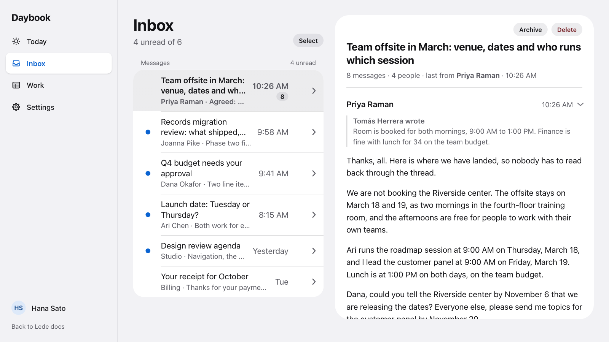

# <picture><source media="(prefers-color-scheme: dark)" srcset=".github/assets/mark-dark.png"></picture> Lede

Lede is a design system for React: components, blocks, layouts and hero flows, installed from a shadcn registry.
Every screen, section and row leads with its takeaway, and detail opens on request. The name is the journalist's word
for a story's opening line, the one that tells the reader what matters.

[Docs](https://lede.cloudcompute.com/) · [Daybook, the demo app](https://lede.cloudcompute.com/app) ·
[Install](#use-it-in-a-shadcn-project) · [Changelog](CHANGELOG.md)

<picture>
  <source media="(prefers-color-scheme: dark)" srcset="docs/screenshots/inbox-dark.png">
  
</picture>

Lede is inspired by Apple's Human Interface Guidelines: **Hierarchy, Harmony, Consistency** and **Progressive
disclosure**.

*Lede is an independent project with no affiliation with Apple, and Apple doesn't endorse it. It ships no Apple fonts,
icons or assets.*

- **Components**: ThemeProvider, Button, SegmentedControl, Switch, TextField, Checkbox, Avatar, Card, ListGroup with
  ListRow, Disclosure, Table and GlassBar with GlassToolbar. Each is a native element where HTML has one, with
  [Base UI](https://base-ui.com) for the interactions HTML can't do and ARIA only for what HTML can't express.
- **Tokens** for color in four themes (`light`, `dark`, `light-hc` and `dark-hc`), type, spacing, radius, motion and
  more. The colors and radius that shadcn/ui defines keep its variable names (`--primary`, `--radius`), so stock shadcn
  components take on Lede too, and Lede's extras have names of their own (`--fill-control`). Tailwind v4 utilities map
  to both (`bg-primary`, `bg-fill-control`, `rounded-lg`).
- **Blocks**: AppShell and WorkbenchShell for page layouts, PageHeader, SummaryCard, MasterDetail, FormSection,
  StepIndicator, EmptyState, SelectionBar, AccentPicker and DataTable. DataTable is a `<table>` with sorting,
  selection, row links, row actions and optional cards for narrow containers, and `useServerRows` can fetch and cache
  its rows from a server.
- **Hero flows**: whole screens assembled from blocks. You pass data, hrefs and callbacks, and a flow fetches nothing
  and imports no router: DailyBriefFlow, InboxFlow (a message list and the open message), SettingsFlow with
  AppearanceFlow, ProfileFlow and OnboardingFlow.
- **Theming**: `--primary` sets the accent, and `--radius` with `--radius-step` sets every corner except those of
  capsules and circles. A capsule is fully round except under ThemeProvider's `shape="square"`, and a Button whose
  label wraps is a rounded rectangle. ThemeProvider sets scheme, contrast, accent, shape, density and glass for a
  subtree. Put ThemeScope directly inside every portal, including one inside another overlay, so its content keeps the
  theme.

## Use it in a shadcn project

Lede installs from its hosted registry. Each release has its own URL, and a release's files never change, so pin the
version in the URL.

You need Node 22.12 or later and a project with React 19, Tailwind v4, the `@/*` path alias and a `components.json`.
`npx shadcn@latest init` creates that file, and stops if the alias is missing.

Lede renders on the client only, so use it in a Vite app or another client-only React app. It doesn't support server
rendering yet: registry files have no `'use client'`, so Next's App Router fails at build. Inside a `'use client'` file
it builds, but `scheme="auto"` doesn't follow a dark OS after hydration.

1. Add the registry and the items you want. Keep `@lede/theme-provider` in the list: step 4 needs it, and most items
   don't install it. The CLI follows each item's `@lede/…` dependencies through the same registry, which brings in
   `lede-theme`, and installs the npm packages they need.

   ```bash
   npx shadcn@latest registry add '@lede=https://lede.cloudcompute.com/r/v0.4.0/{name}.json'
   npx shadcn@latest add @lede/theme-provider @lede/data-table @lede/daily-brief @lede/inbox
   ```

   The CLI copies the source into your project. The registry URL stays in `components.json`, so a later `add` installs
   from the same release.

2. Import the styles once, at the end of your global CSS file, after your shadcn globals. The path is relative to that
   file. This one suits `src/index.css`.

   ```css
   @import "./styles/lede/index.css";
   ```

3. Import each component from its own file. Components land in `components/lede/` and styles in `styles/lede/`, under
   `src/` if your project has one. There is no barrel file.

   ```tsx
   import { ListGroup, ListRow } from '@/components/lede/list';
   ```

4. Wrap your app in `ThemeProvider` and `LinkProvider`. `body` stays white, so `surface="grouped"` and `min-h-dvh` make
   the wrapper paint the theme's background and cover it. Without them a dark theme puts light text on white.
   `LinkProvider` routes Lede's links through your router, so leave it out if you have none.

   ```tsx
   import { LinkProvider } from '@/components/lede/link';
   import { ThemeProvider } from '@/components/lede/theme-provider';
   import { RouterLink } from './router-link';

   <ThemeProvider surface="grouped" className="min-h-dvh">
     <LinkProvider component={RouterLink}>
       <App />
     </LinkProvider>
   </ThemeProvider>
   ```

   For React Router, `src/router-link.tsx` is this adapter.

   ```tsx
   import { Link } from 'react-router';
   import type { LinkComponent } from '@/components/lede/link';

   export const RouterLink: LinkComponent = ({ href, ref, ...props }) =>
     /^(https?:|mailto:|tel:|#)/.test(href) ? <a ref={ref} href={href} {...props} /> : <Link ref={ref} to={href} {...props} />;
   ```

To move to a later release, read the [CHANGELOG](CHANGELOG.md), change the version in the registry URL in
`components.json` and run the same `add` with `-o`. That overwrites your copies, including any edits you made to them.

The CLI's `owner/repo/item#tag` addresses don't work for Lede. `lede-theme` needs `lede.tokens.css`, which the build
generates, and the `@lede/…` dependencies need a registry.

## Develop

The docs site and Daybook run at http://localhost:5173 with `npm run dev`. Run `npm run build` before `npm test`.

```bash
npm install
npx playwright install chromium   # first run only
npm run dev        # the docs site and Daybook
npm run build      # tokens, registry, typecheck, then the site
npm test           # Playwright and axe on every route, in four themes
npm run contrast   # the contrast check alone
```

[CONTRIBUTING.md](CONTRIBUTING.md) covers how the code is organized, the rules every component follows, pull
requests and writing.

## License

[MIT](LICENSE). Lede builds on [Base UI](https://base-ui.com) (MIT), [React Aria](https://react-spectrum.adobe.com/react-aria/) (Apache-2.0) and [TanStack Table](https://tanstack.com/table) (MIT).
